<div align="center">

# ServiceQualityHub

**One service catalogue, one SLA engine and one set of KPIs for every plant of a multi-site manufacturer —
with supplier scorecards, problem candidates, an improvement register and a one-click monthly service review.**

[](https://github.com/vladimirmilivojevic-creator/service-quality-hub/actions/workflows/ci.yml)


### [▶ Open the live demo](https://servicequalityhub.vercel.app)

[API docs (OpenAPI)](https://service-quality-hub-api.vercel.app/docs) ·
[How it works](https://servicequalityhub.vercel.app/how-it-works) ·
[Process documentation](docs/processes/README.md)

</div>

<p align="center">
  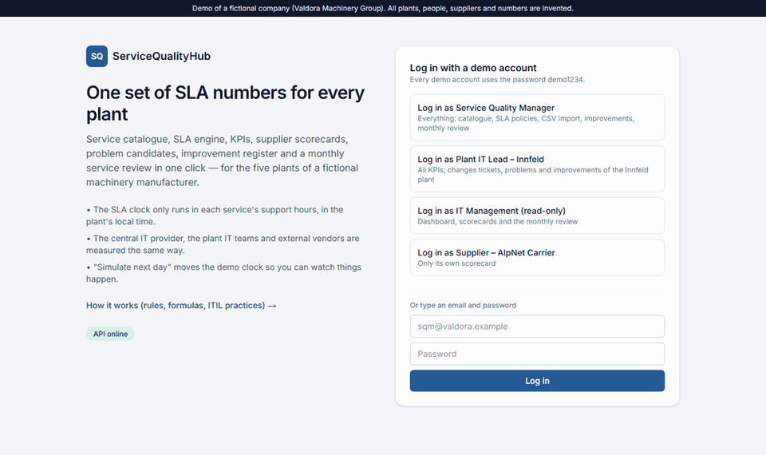
</p>

> [!NOTE]
> The company **Valdora Machinery Group**, its five plants, people, suppliers and all numbers are **fictional**.
> The demo runs on free hosting (Vercel + Neon PostgreSQL). After a quiet period the database wakes up on the first
> request, which can take a few seconds.

## What it does

A manufacturer with five plants gets IT services from a central IT provider, from each plant's own IT team and from
external vendors. ServiceQualityHub answers the questions a service quality manager is asked every month:
*Do we deliver the agreed service at every plant? Which provider misses its agreement? What keeps breaking, and what
are we doing about it?*

- **Service catalogue & portfolio** with service owners, support hours, criticality and SLA targets per priority
  (pipeline / live / retired).
- **SLA engine**: response and resolution timers that only run in the service's support hours, in the plant's local
  time, and stop while waiting for the user; breach detection and "at risk" warnings.
- **KPIs per plant, service and provider**: SLA compliance, MTTR, backlog age, reopen rate, change success rate —
  each with a definition, a formula and a red/amber/green target.
- **Supplier scorecards** that compare the central IT provider, the plant IT teams (OLA) and external vendors
  (contract) on the same numbers.
- **Problem candidates**: recurring incidents are flagged and turned into a problem record with one click.
- **Improvement register (CSI)** with owners, due dates, KPI baseline and target, and overdue tracking.
- **Monthly service review in one click**, printable as A4 / PDF and exportable to Excel.
- **CSV import of Jira Service Management exports** (pandas), idempotent, with a preview and row-level reasons for
  skipped rows.

## Try it in 30 seconds

Open the [live demo](https://servicequalityhub.vercel.app) and click one of the **"Log in as …"** buttons
(password for all accounts: `demo1234`).

| Role | Login | What this role sees and does |
|---|---|---|
| Service Quality Manager | `sqm@valdora.example` | Everything: catalogue and SLA policy, CSV import, problems, improvements, monthly review, reset demo |
| Plant IT Lead – Innfeld | `it.innfeld@valdora.example` | All KPIs; changes tickets, problems and improvements of the Innfeld plant only |
| IT Management (read-only) | `cio@valdora.example` | Dashboard, scorecards and the monthly review |
| Supplier – AlpNet Carrier | `supplier.alpnet@valdora.example` | Only its own scorecard |

Then try **"Simulate next day ▶"** (the demo has its own clock) and **"Generate monthly service review"**.

### Six stories built into the demo data

1. **AlpNet Carrier** (WAN) misses its 97 % contract at **Vale Verde** in September and October → red scorecard →
   improvement "quarterly service review, second line, escalation contact".
2. **Innfeld**: "MES terminal freezes at line 3" four times in ten days → problem → firmware change → freezes stop.
3. **Salzbach**: label printers repaired slowly in September (MTTR 18 h), fast in October (1.4 h) after spare printers
   were put on site.
4. A **Friday-evening ERP release** breaks goods-receipt booking at three plants → change success rate drops to 90 % →
   rule "no ERP changes on Fridays, freeze before month-end closing".
5. **Illerau**: device requests waiting for a budget decision since September → backlog older than 30 days is amber.
6. **Rhinval**: Workplace tickets are often reopened → improvement "resolve only after the user confirms".

## Highlights

| Catalogue & SLA policies | SLA engine | KPI dashboard |
|---|---|---|
| 11 live services + pipeline and retired ones; default SLA policy per priority with service exceptions (MES has tighter P1/P2 targets) | Support-hour calendars (24x7, shift, office) in each plant's time zone (Austria, Germany, France, Brazil), pauses, due dates, daylight-saving safe | Six KPI cards with ⓘ definitions, RAG colours, change vs last month, six-month sparklines; plants side by side |
| **Supplier scorecards** | **Problem candidates** | **Monthly service review & CSI register** |
| Central provider, plant IT teams (OLA) and vendors (contract) on one chart; trend, breaches, top services with breaches, P1s | ≥ 3 similar incidents (same plant + service + category) in 14 days → candidate → one-click problem with linked incidents | Ten-section review (summary, KPIs, plants, suppliers, breaches, P1s, problems, changes, improvements, next actions); PDF and Excel |

## Screenshots

| Dashboard | Supplier scorecards |
|---|---|
| 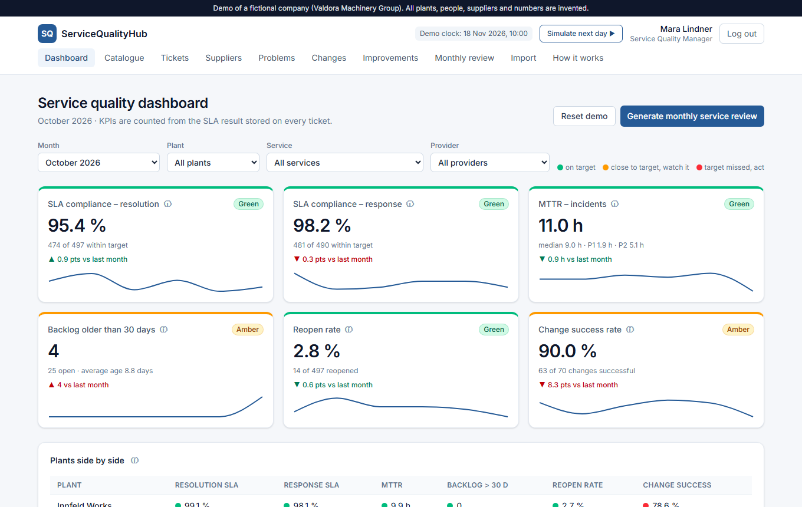 | 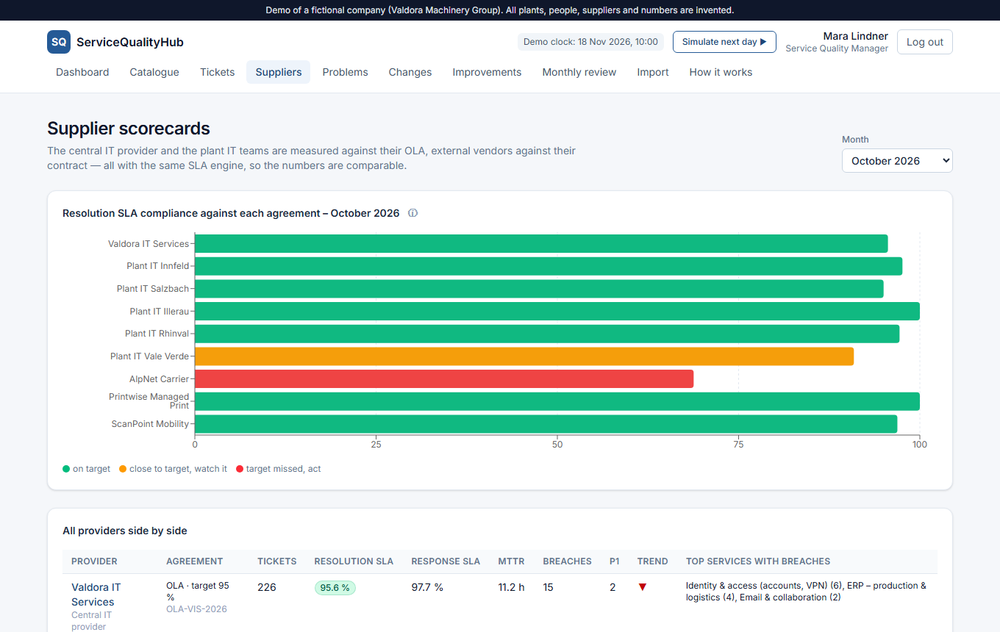 |
| **Problem candidates** | **Monthly service review** |
| 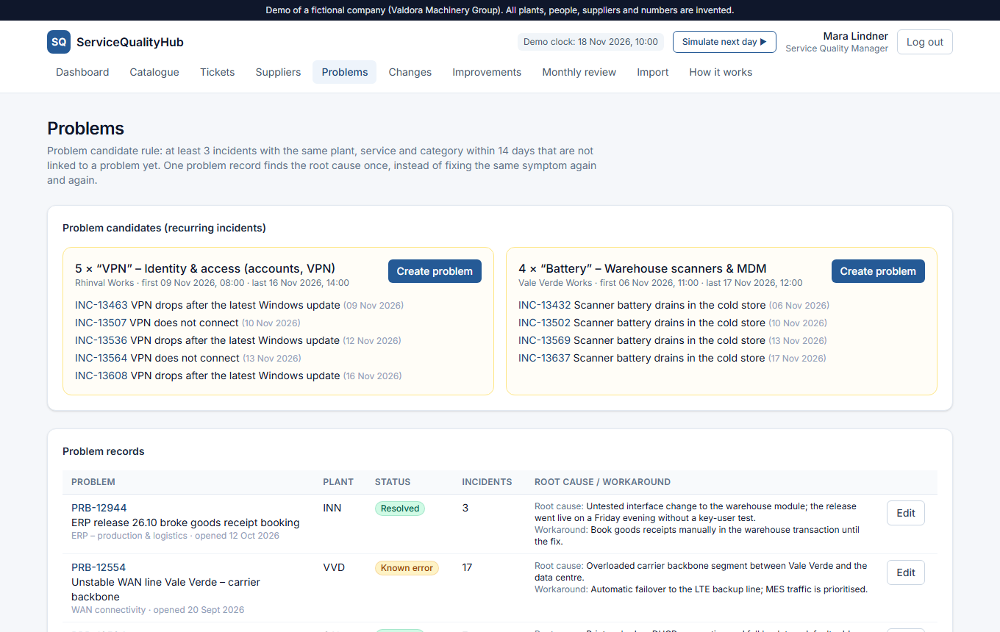 | 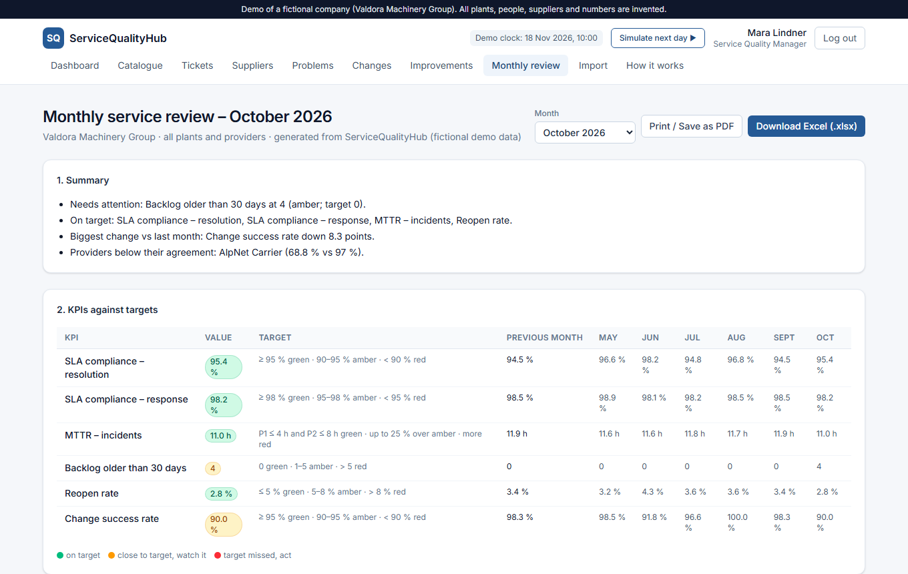 |

## Architecture

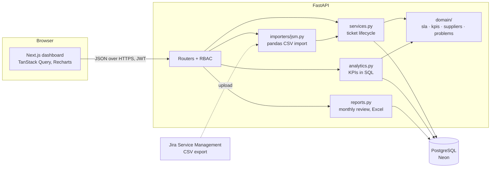

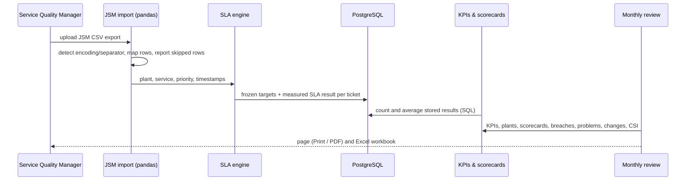

## Tech stack

| Layer | Technology |
|---|---|
| API | Python 3.12, FastAPI, Pydantic v2, SQLAlchemy 2.0 (async), Alembic |
| Data | PostgreSQL 16 (Neon in production, service container in CI); SQLite for fast local tests |
| Import & reports | pandas, openpyxl |
| Auth | JWT (PyJWT), bcrypt, role checks as FastAPI dependencies |
| Frontend | Next.js 16 (App Router), React 19, TypeScript, Tailwind CSS 4, TanStack Query, Recharts |
| Quality | pytest (98 % coverage, gate at 85 %), Playwright end-to-end, ruff, ESLint, Prettier, `tsc` |
| Delivery | GitHub Actions, Docker / docker compose, Vercel (dashboard and API) + Neon; `render.yaml` blueprint as alternative |

## KPIs, formulas and targets

| KPI | Formula | Green / amber / red |
|---|---|---|
| SLA compliance – resolution | resolved within target ÷ resolved in period × 100 | ≥ 95 / 90–95 / < 90 % |
| SLA compliance – response | responded within target ÷ responded in period × 100 | ≥ 98 / 95–98 / < 95 % |
| MTTR (incidents) | average resolution time in support hours (median and per priority shown) | P1 ≤ 4 h and P2 ≤ 8 h; up to 25 % over = amber |
| Backlog older than 30 days | open incidents and requests older than 30 days at period end | 0 / 1–5 / > 5 |
| Reopen rate | resolved tickets reopened at least once ÷ resolved × 100 | ≤ 5 / 5–8 / > 8 % |
| Change success rate | successful changes ÷ completed changes × 100 | ≥ 95 / 90–95 / < 90 % |

All targets live in one place ([`backend/app/domain/kpis.py`](backend/app/domain/kpis.py)) and the
"How it works" page shows exactly these values.

**SLA rules in one sentence:** the SLA clock only runs during the service's support hours, in the plant's local time,
and it stops while we wait for the user. Priority = impact × urgency (3 × 3 matrix). Default targets (first response /
resolution): P1 15 min / 4 h · P2 30 min / 8 h · P3 2 h / 16 h · P4 8 h / 40 h.

## Feature → ITIL 4 practice

| Feature | ITIL 4 practice |
|---|---|
| Service catalogue & portfolio (pipeline / live / retired) | Service catalogue management, portfolio management |
| SLA targets per priority, support hours, OLA and contract targets | Service level management |
| Incidents with impact × urgency and a live SLA clock | Incident management |
| Service requests (accounts, devices, restores) | Service request management |
| Problem candidates, problem records, known errors | Problem management |
| Changes (standard / normal / emergency), change success rate | Change enablement |
| Supplier scorecards | Supplier management, relationship management |
| KPI dashboard, plant comparison, trends | Measurement and reporting |
| Improvement register | Continual improvement |
| Monthly service review | Service level management, continual improvement |

**Process documentation** (purpose, RACI, flowchart, rules, KPIs) for
[incident](docs/processes/incident.md), [service request](docs/processes/service-request.md),
[problem](docs/processes/problem.md), [change](docs/processes/change.md) and
[service review](docs/processes/service-review.md) — a short guide for plant IT teams is in
[docs/processes/README.md](docs/processes/README.md).

## Works with Jira Service Management exports

In Jira: *Filters → Export → Export CSV (all fields)*, then upload the file on the **Import** page.

- Detects UTF-8 / UTF-8 with BOM / Windows-1252 and comma or semicolon (Excel in Austria and Germany).
- Reads repeated columns for multi-value fields (`Labels`, `Labels.1`, …), several date formats
  (`21/Nov/26 3:45 PM`, ISO, `21.11.2026 15:45`), plant from *Site* / *Components* / *Labels*, service from labels or
  request type; all mapping rules are in one file: [`jsm_mapping.py`](backend/app/importers/jsm_mapping.py).
- **Preview first**, then import. **Idempotent**: tickets are matched by issue key, a second import updates them.
- Skipped rows are listed with row number and reason (unknown plant, unsupported issue type, unreadable date …).
- **One SLA engine for all sources**: JSM's own SLA fields are kept only as a reference note, so plants stay comparable.

A sample export with fictional data is in [`samples/jsm_export_sample.csv`](samples/jsm_export_sample.csv).

**Tested with a real Jira Service Management Free site.** I set up a service space with the IT service management
template, SLA goals per priority on a business-hours calendar (Mon–Fri 07:00–17:00, Europe/Vienna, paused while
*Waiting for customer*) and a queue for tickets at risk, created tickets that follow the demo stories (breaches, one
*Waiting for customer*, one reopened), exported them with *Export → CSV – all fields* and imported the file. The
anonymized export is in [`samples/jsm_export_real_anonymized.csv`](samples/jsm_export_real_anonymized.csv) and a test
imports it ([`test_real_jsm_cloud_export`](backend/tests/test_import_and_simulation.py)). What the real export taught
the importer: repeated `Labels` columns, `IT Help` and `Reopened` values, SLA fields as remaining time (`-49:30` =
breached) and a first-response date written in UTC with milliseconds.

| JSM SLA goals on a business-hours calendar | JSM queue "SLA at risk or breached" |
|---|---|
| 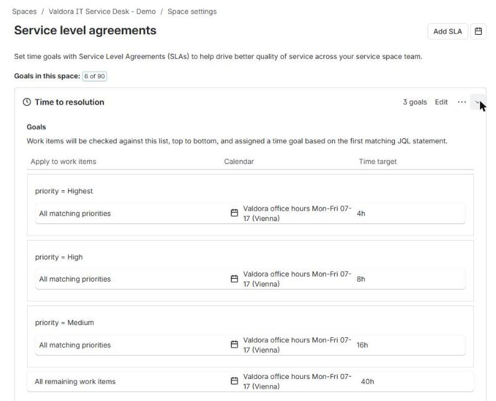 | 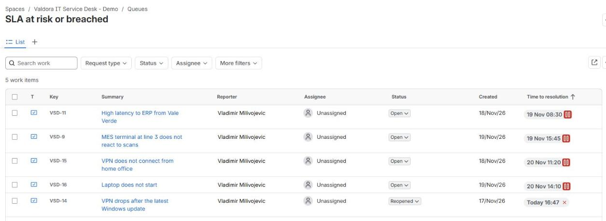 |

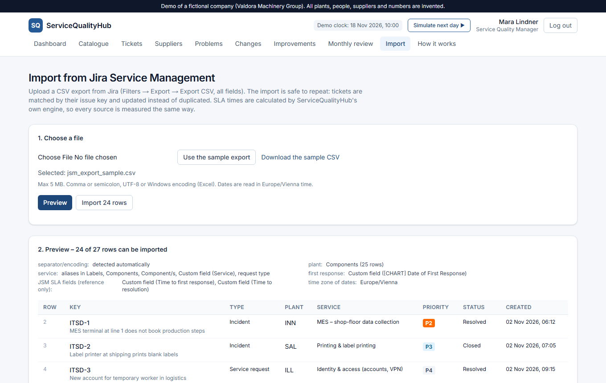

## API overview

Full interactive docs: [`/docs`](https://service-quality-hub-api.vercel.app/docs).

| Area | Endpoints |
|---|---|
| Health | `GET /health` (no database), `GET /health/db` |
| Auth | `POST /auth/login`, `GET /auth/me` |
| Catalogue | `GET /plants`, `GET /services`, `PATCH /services/{id}`, `GET /meta` |
| Tickets | `GET /tickets`, `GET/PATCH /tickets/{id}` |
| KPIs | `GET /kpis`, `GET /kpis/trend`, `GET /kpis/by-plant` |
| Suppliers | `GET /suppliers`, `GET /suppliers/{id}/scorecard` |
| Problems | `GET /problems/candidates`, `GET/POST /problems`, `GET/PATCH /problems/{id}` |
| Changes | `GET /changes` |
| Improvements | `GET/POST /improvements`, `PATCH /improvements/{id}` |
| Reports | `GET /reports/monthly`, `GET /reports/monthly.xlsx` |
| Import | `POST /imports/jsm/preview`, `POST /imports/jsm` |
| Demo | `GET /demo/clock`, `POST /simulate/next-day`, `POST /demo/reset` |

## Tests and CI

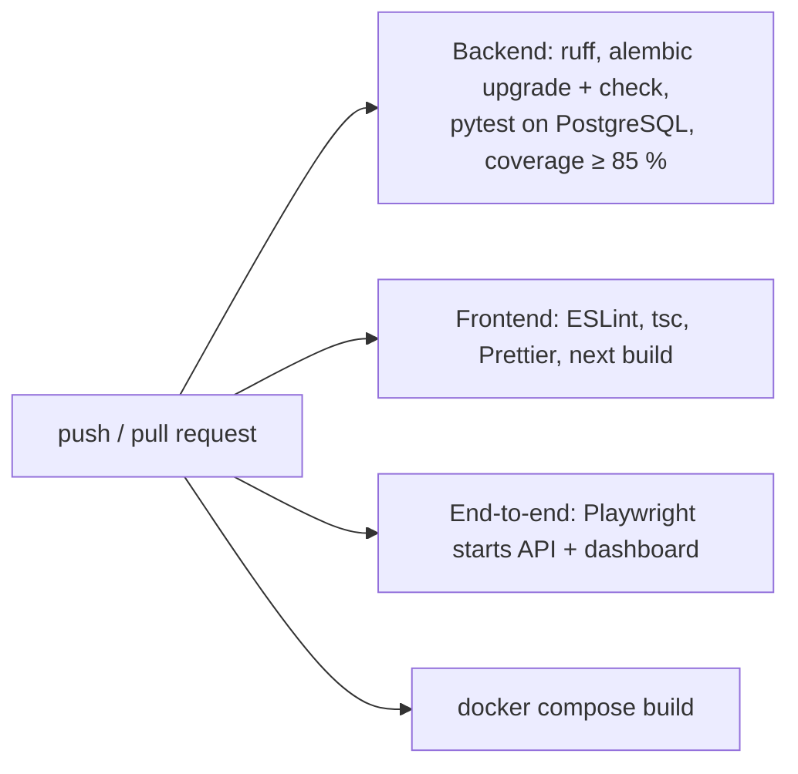

- 100+ backend tests: the SLA engine (24x7, nights and weekends, daylight-saving changes, Brazil, pauses, exactly on
  target), KPI and scorecard rules, every role's permissions, the stories in the demo data with fixed numbers, the
  monthly report (same month → same report), the Excel file, the JSM import (encodings, separators, repeated columns,
  bad files, idempotency) and the simulator.
- Playwright: login, dashboard, the main story (red supplier → improvement → problem candidate → monthly review →
  Excel download), simulation, import, roles, public "How it works" page.

<details>
<summary><strong>Run locally</strong></summary>

**Without Docker** (Python 3.12+ and Node 22):

```bash
# API on http://localhost:8000 (SQLite file, demo data is created on the first start)
cd backend
python -m venv .venv
.venv/bin/pip install -r requirements-dev.txt        # Windows: .venv\Scripts\pip ...
.venv/bin/uvicorn app.main:app --reload
.venv/bin/pytest                                     # tests

# Dashboard on http://localhost:3000
cd frontend
npm install
npm run dev
```

**With Docker** (PostgreSQL, API with Alembic migrations, dashboard):

```bash
docker compose up --build
```

</details>

## Design decisions

- **The SLA target is frozen on the ticket.** Targets are copied onto the ticket when it is created, and the measured
  result is stored when it is resolved. KPIs are then simple SQL counts, reports are fast, and changing a target never
  rewrites last month's numbers. (A test changes a service's target and checks that old tickets keep theirs.)
- **One SLA engine for all sources.** Seeded, simulated and imported tickets are measured by the same pure functions
  in [`domain/sla.py`](backend/app/domain/sla.py). Business time is calculated in UTC spans inside local support
  windows, because Python subtracts *wall-clock* times when two datetimes share a time zone — which would be wrong on
  the days the clocks change.
- **The demo has its own clock.** Every "now" comes from the database, never from the system clock, so the demo and
  the tests are reproducible and "Simulate next day" can move time forward. Demo data comes from a fixed random seed.
- **Bugs the tests caught:** after a commit, async SQLAlchemy cannot lazy-load relationships, so creating an
  improvement returned HTTP 500 (`MissingGreenlet`) — the API tests found it and the fix loads the names explicitly.
  A PostgreSQL-only test opens five parallel database sessions to prove that ticket numbers are handed out under
  `SELECT … FOR UPDATE` and never twice.
- **Simple, explainable rules** instead of scoring models: every threshold is a named constant that can be read
  aloud in a meeting.

## Roadmap

- [ ] Live connection to the Jira Service Management or ServiceNow API (today: CSV export)
- [ ] Public holidays per country in the support-hour calendars
- [ ] Email notifications for tickets at risk and overdue improvement actions
- [ ] Availability SLAs from monitoring data (today: ticket-based SLAs only)
- [ ] Real data instead of the fictional demo company

---

<div align="center">

Built by **Vladimir Milivojevic** · [GitHub](https://github.com/vladimirmilivojevic-creator) · MIT License

</div>
