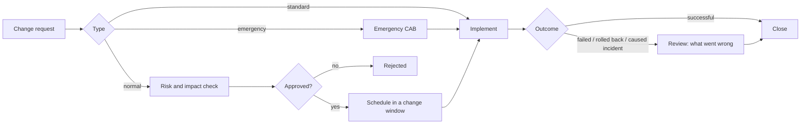

# Change enablement

**Purpose:** make changes to IT services quickly **and** without breaking production.
**Scope:** every change to a catalogue service at any plant: software releases, patches, configuration, hardware.

## Change types

| Type | Meaning | Approval |
|---|---|---|
| Standard | Pre-approved, low risk, repeated often (monthly patches, new Wi-Fi access point from template) | none, just log it |
| Normal | Assessed for risk and impact | Service owner; CAB for high risk or several plants |
| Emergency | Needed now to fix a P1 or a security risk | Emergency CAB (2 people), reviewed afterwards |

## Roles (RACI)

| Step | Requester | Plant IT / central IT | Service owner | CAB | SQM |
|---|---|---|---|---|---|
| Raise change with plan and back-out | R | R | C | – | – |
| Risk and impact assessment | C | R | A | C | – |
| Approve normal change | – | – | A | R (high risk) | I |
| Implement in the agreed window | – | R/A | I | – | – |
| Post-implementation review | – | R | A | C | I |
| Monthly change success rate | – | C | C | C | R/A |

## Steps

## Rules in a plant

- Normal changes in the agreed window (Tue–Thu after the day shift). **No ERP changes on Fridays.**
- **Change freeze** 3 working days before month-end closing and during the annual maintenance shutdown, except
  emergencies.
- Key-user test before a release goes live; a back-out plan is mandatory.
- Example from the demo: a Friday-evening ERP release broke goods-receipt booking at three plants on Monday morning →
  change success rate fell below target → new rule in the improvement register.

## KPI

Change success rate = successful changes ÷ completed changes × 100 (failed, rolled back or incident-causing changes
are not successful). Target ≥ 95 %.

## How ServiceQualityHub supports it

Change list per month and plant, outcome per change, link from incidents to the change that caused them, change success
rate per plant on the dashboard and in the monthly service review.
