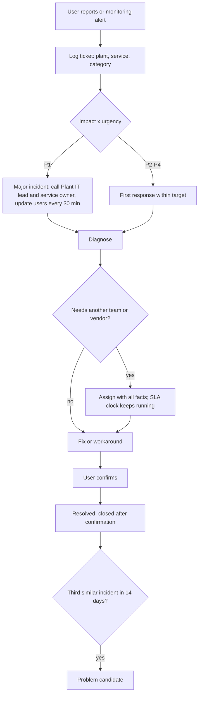

# Incident management

**Purpose:** restore normal service as quickly as possible and keep the impact on production low.
**Scope:** all catalogue services at all plants; unplanned interruptions or quality loss of an IT service.
Planned work is a change; a standard request for something new is a service request.

## Roles (RACI)

| Step | Service desk | Plant IT | Central IT / vendor | Service owner | SQM |
|---|---|---|---|---|---|
| Log and classify | R/A | C | – | – | I |
| Prioritise (impact × urgency) | R/A | C | – | – | – |
| Diagnose and resolve | R | R/A (plant services) | R/A (their services) | C | – |
| Major incident (P1) coordination | I | R | R | A | I |
| Confirm with user and close | R/A | R | – | – | – |
| Monthly KPI review | – | C | C | C | R/A |

## Steps

## Rules and SLA

- Priority: impact (how many users / is production affected) × urgency (how fast it hurts). P1 = production line
  stopped or many users without a workaround.
- Default targets (first response / resolution, in support hours): P1 15 min / 4 h · P2 30 min / 8 h ·
  P3 2 h / 16 h · P4 8 h / 40 h. MES has tighter P1/P2 targets because it stops production lines.
- The clock stops only in *Pending* (waiting for the user). Waiting for a vendor does **not** stop it: the vendor is
  part of our service, and its contract is measured on the supplier scorecard.
- *Resolved* only after the user confirms; a reopened ticket keeps its original start time.

## KPIs

Resolution and response SLA compliance, MTTR per priority (mean and median), backlog and backlog age, reopen rate.

## How ServiceQualityHub supports it

Live SLA clock with due dates in plant time, "at risk" at 75 % of the target, the frozen target on every ticket,
KPIs per plant / service / provider and the list of open tickets at risk on the dashboard.
