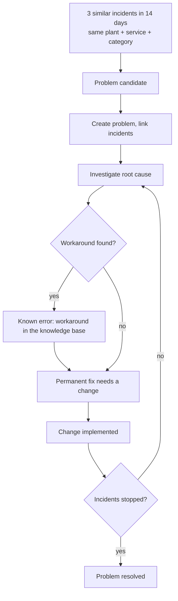

# Problem management

**Purpose:** find the root cause of incidents and remove it, so the same incident does not come back.
**Scope:** recurring incidents (reactive) and risks seen in trends or monitoring (proactive).

## Roles (RACI)

| Step | Plant IT | Central IT / vendor | Service owner | SQM |
|---|---|---|---|---|
| Spot a candidate (rule or trend) | R | R | C | A |
| Open the problem, link incidents | R | R | A | I |
| Root cause analysis (5 Whys, Ishikawa) | R | R | A | C |
| Document workaround → known error | R | R | A | I |
| Permanent fix via a change | R | R | A | I |
| Close and check the trend | C | C | A | R |

## Steps

## Rules

- **Candidate rule:** at least 3 incidents with the same plant, service and category within 14 days that are not yet
  linked to a problem.
- A problem can become a **known error** only with a documented workaround, and **resolved** only with a documented
  root cause.
- Example from the demo: "MES terminal freezes at line 3" → root cause firmware 4.2 memory leak → workaround "restart at
  shift change" → firmware 4.3 change → no more freezes.

## KPIs

Number of open problems and their age, incidents linked to known errors, recurring incidents after the fix.

## How ServiceQualityHub supports it

Automatic candidate list, one-click "Create problem" that links the incidents, status rules (known error needs a
workaround, resolved needs a root cause), problems and candidates in the monthly service review.
