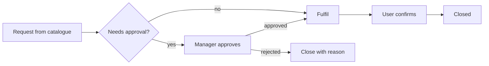

# Service request management

**Purpose:** deliver standard, pre-defined requests (new account, password reset, new laptop, software install,
restore of a file) in a predictable time with a clear approval.
**Scope:** requests listed in the request catalogue. Anything not listed is a project or a change.

## Roles (RACI)

| Step | User / manager | Service desk | Plant IT / central IT | Service owner | SQM |
|---|---|---|---|---|---|
| Submit request from the catalogue | R | I | – | – | – |
| Approval (cost or access) | A (manager) | R | – | C | – |
| Fulfil | I | R | R/A | – | – |
| Keep request catalogue current | – | C | C | R/A | C |

## Steps

## Rules and SLA

- Requests use P3 (needed for work today) or P4 (standard). Targets: P3 2 h / 16 h, P4 8 h / 40 h.
- Waiting for an approval or for the user is *Pending* (clock stopped). A request waiting weeks for a budget decision
  should be cancelled or decided — it shows up as backlog older than 30 days.

## KPIs

Resolution SLA compliance, backlog older than 30 days, share of requests that could be self-service.

## How ServiceQualityHub supports it

Request categories per service, backlog age buckets (0–2 / 3–7 / 8–30 / > 30 days) and the improvement register
(e.g. "self-service password reset").
