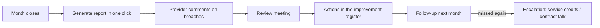

# Service review

**Purpose:** check every month, together with each provider, whether the agreed service was delivered, and agree
corrective actions where it was not.
**Scope:** the central IT provider and every plant IT team (OLA), and every external vendor (contract).

## Roles (RACI)

| Step | SQM | Provider | Service owners | Plant IT leads | IT management |
|---|---|---|---|---|---|
| Generate the monthly report | R/A | I | I | I | I |
| Prepare comments on breaches | C | R | C | C | – |
| Run the review meeting | R/A | R | C | C | I |
| Agree actions (owner, date, KPI target) | R | R | C | C | I |
| Follow up open and overdue actions | R/A | R | C | C | I |
| Escalate repeated misses | R | I | C | – | A |

## Agenda (45–60 minutes)

1. Summary: what is red, what changed since last month
2. KPIs against targets with a six-month trend
3. Plants side by side
4. Supplier scorecard: compliance against the agreement, breaches, P1 incidents, trend
5. Top 10 breaches: the provider explains causes
6. P1 / major incidents
7. Problems and problem candidates
8. Changes: success rate and failed changes
9. Improvement register: open, done, overdue
10. Actions for next month: owner, due date, expected KPI effect

## Rules

- A provider below its target is red when it is more than 5 points under target; red two months in a row means an
  escalation to the provider's management and a written action plan.
- Every action has one owner, a due date and the KPI it should move (baseline → target).
- Numbers come from one SLA engine for all sources, so internal teams and vendors are compared fairly.

## How ServiceQualityHub supports it

"Generate monthly service review" builds the full agenda as a page (Print / Save as PDF, A4) and as an Excel file;
supplier scorecards and the improvement register feed it; overdue actions are listed automatically.
